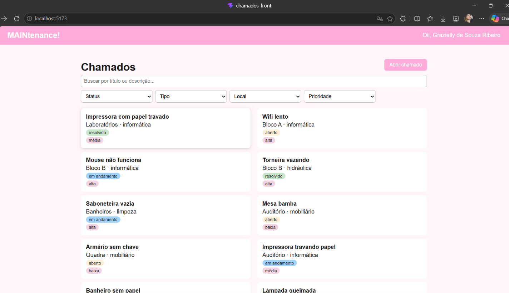
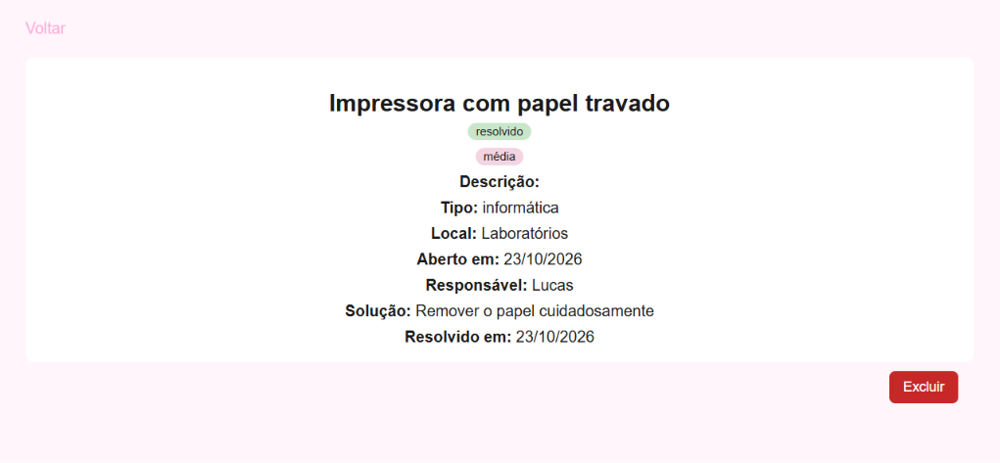
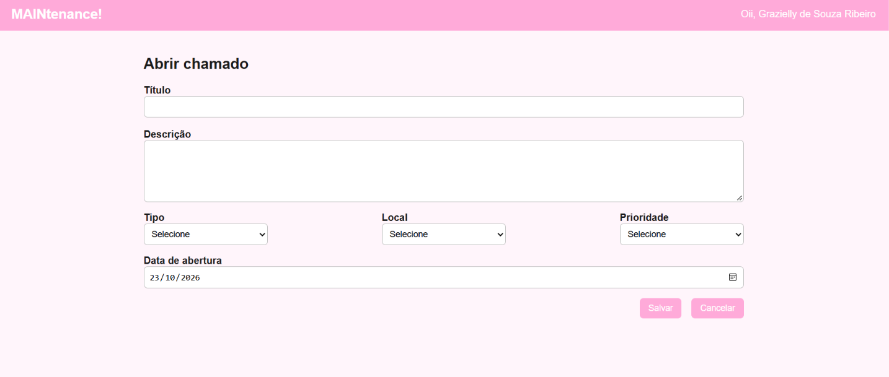
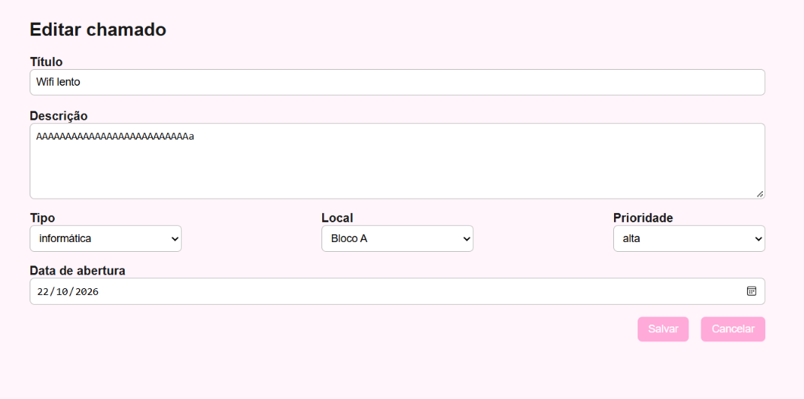

# MAINTenance! 💗

Front-end do Sistema de Chamados de Manutenção do **IFRN Campus Pau dos Ferros**.
Permite abrir chamados, acompanhar o atendimento e registrar a solução de cada um, consumindo uma API real.

**Aluna:** Grazielly de Souza Ribeiro
**Curso:** Técnico Integrado em Informática
**Disciplina:** Programação para Internet

---

## Tela inicial

<!-- 1) Salve o print na raiz do projeto com o nome print-home.png -->
<!-- 2) O print deve mostrar o seu nome no topo e a lista com os seus chamados -->



---

## Outras telas

### Detalhe do chamado

<!-- Salve como print-detalhe.png (opcional) -->



### Formulário (abrir e editar)

<!-- Salve como print-formulario.png (opcional) -->




---

## Funcionalidades

- Nome do dono da chave de API exibido no topo
- Lista de chamados com busca por texto
- Filtros por status, tipo, local e prioridade
- Detalhe do chamado na rota `/chamado/:id`
- Abrir chamado, com tipo, local e prioridade carregados da API
- Editar chamado reaproveitando o mesmo formulário (chamados resolvidos não podem ser editados)
- Iniciar atendimento (informando o responsável) e resolver chamado (informando a solução)
- Excluir chamado com confirmação
- Mensagens de carregando, lista vazia e erros vindos da API

## Tecnologias

- React
- Vite
- React Router
- Axios

## Rotas

| Rota | Tela |
|---|---|
| `/` | Lista de chamados |
| `/chamado/:id` | Detalhe do chamado |
| `/novo` | Abrir chamado |
| `/editar/:id` | Editar chamado |

## Estrutura do projeto

```
src/
├── components/   # Header
├── pages/        # Home, Detalhe, Formulario
├── services/     # api.js (instância do Axios) e listas.js
├── utils/        # helpers.js (mensagens de erro e formatação de data)
├── App.jsx       # Rotas
└── main.jsx      # Ponto de entrada
```

## Como rodar

1. Clone o repositório:
   ```bash
   git clone https://github.com/SEU-USUARIO/chamados-front.git
   cd chamados-front
   ```
2. Instale as dependências:
   ```bash
   npm install
   ```
3. Crie um arquivo `.env` na raiz do projeto com a sua chave de API:
   ```
   VITE_API_KEY=sua-chave-aqui
   ```
4. Inicie o servidor de desenvolvimento:
   ```bash
   npm run dev
   ```
5. Abra o endereço mostrado no terminal (geralmente `http://localhost:5173`).

> O arquivo `.env` não é enviado ao GitHub. Cada pessoa precisa criar o seu com a sua própria chave.

## API
- Documentação: https://api-chamados.jefersonqueiroga.com.br/docs
